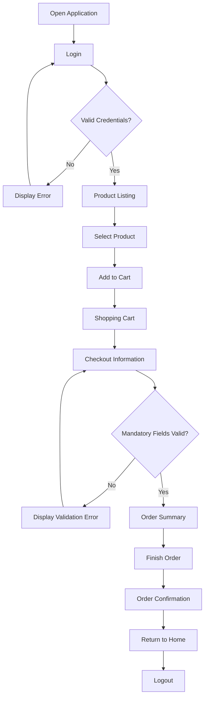
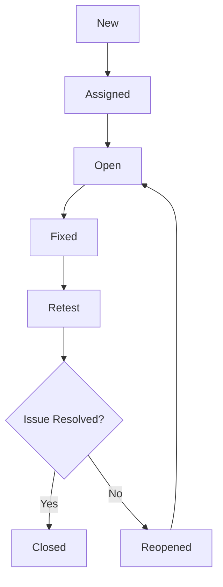
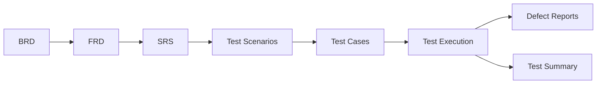

# Software Requirement Specification (SRS)

## 1. Document Information

| Field | Details |
|---|---|
| Project Name | SauceDemo E-commerce Application |
| Document Type | Software Requirement Specification |
| Version | 1.0 |
| Prepared By | Vishal Sharma |
| Role | QA Engineer - Independent Practice Project |
| Status | Draft |
| Application URL | https://www.saucedemo.com/ |
| Business Requirements | [BRD](BRD.md) |
| Functional Requirements | [FRD](FRD.md) |

## 2. Introduction

### 2.1 Purpose

This Software Requirement Specification defines
the proposed functional, non-functional, interface,
data and operational requirements for the SauceDemo
e-commerce web application.

It provides a structured reference for software
testing, requirement validation, test case design,
defect management and quality assurance reporting.

### 2.2 Product Scope

The application allows users to authenticate,
browse products, manage shopping cart items
and complete a simulated purchase.

The primary objective is to validate application
behavior, business workflows, data consistency,
usability and software quality.

### 2.3 Definitions and Abbreviations

| Term | Description |
|---|---|
| SRS | Software Requirement Specification |
| BRD | Business Requirement Document |
| FRD | Functional Requirement Document |
| QA | Quality Assurance |
| QC | Quality Control |
| SDLC | Software Development Life Cycle |
| STLC | Software Testing Life Cycle |
| RTM | Requirement Traceability Matrix |
| UAT | User Acceptance Testing |
| UI | User Interface |
| UX | User Experience |
| E2E | End-to-End Testing |
| NFR | Non-Functional Requirement |
| AUT | Application Under Test |
| RCA | Root Cause Analysis |
| KPI | Key Performance Indicator |
| SLA | Service Level Agreement |
| POC | Proof of Concept |

## 3. Overall Product Description

### 3.1 Product Perspective

SauceDemo is a browser-based demonstration
application representing an e-commerce
shopping experience.

The application supports authentication,
product browsing, cart management and
simulated order completion.

Internal application architecture is unavailable
and is outside the scope of this specification.

### 3.2 Product Functions

- User authentication
- Product listing
- Product details
- Product sorting
- Shopping cart management
- Checkout information
- Order summary
- Order confirmation
- Application navigation
- Logout
- Session management
- Error handling

### 3.3 User Characteristics

| User Type | Description |
|---|---|
| Valid User | User with authorized credentials |
| Invalid User | User with incorrect credentials |
| Locked-Out User | User with restricted access |
| Unauthenticated User | User without an active authenticated session |
| QA Tester | User performing application validation |

### 3.4 Operating Environment

| Component | Specification |
|---|---|
| Application Type | Web Application |
| Operating System | Windows |
| Primary Browser | Google Chrome |
| Secondary Browser | Microsoft Edge |
| Environment | Public Demo |
| Internet Connection | Required |
| Desktop Testing | In Scope |
| Mobile Viewport Testing | In Scope |
| Native Android Testing | Out of Scope |
| Native iOS Testing | Out of Scope |
| Browser Versions | To be recorded during execution |

## 4. System Functional Requirements

| SRS ID | Module | Requirement | FRD Reference |
|---|---|---|---|
| SRS-001 | Authentication | System shall support valid user authentication. | FR-001 to FR-008 |
| SRS-002 | Product Listing | System shall display available products and associated information. | FR-009 to FR-014 |
| SRS-003 | Product Sorting | System shall support available product sorting options. | FR-015 to FR-019 |
| SRS-004 | Product Details | System shall display selected product information. | FR-020 to FR-023 |
| SRS-005 | Shopping Cart | System shall support adding, removing and viewing selected products. | FR-024 to FR-032 |
| SRS-006 | Checkout | System shall collect and validate required customer information. | FR-033 to FR-039 |
| SRS-007 | Order Summary | System shall display order details and accurate calculations. | FR-040 to FR-046 |
| SRS-008 | Order Confirmation | System shall display successful purchase confirmation. | FR-047 to FR-050 |
| SRS-009 | Navigation and Logout | System shall support navigation and authenticated session termination. | FR-051 to FR-056 |
| SRS-010 | UI and Error Handling | System shall provide functional controls, readable content and appropriate errors. | FR-057 to FR-062 |

Detailed functional requirements are maintained
in the linked FRD document.

## 5. External Interface Requirements

### 5.1 User Interface Requirements

| ID | Requirement |
|---|---|
| UI-001 | Login page shall display username and password fields. |
| UI-002 | Password input shall be masked. |
| UI-003 | Buttons shall be identifiable and functional. |
| UI-004 | Product images and information shall be visible. |
| UI-005 | Navigation controls shall remain usable. |
| UI-006 | Shopping cart indicator shall reflect selected items. |
| UI-007 | Error messages shall be visible and understandable. |
| UI-008 | Checkout fields shall have identifiable purposes. |
| UI-009 | Order summary shall display relevant purchase information. |
| UI-010 | Confirmation page shall communicate successful order completion. |
| UI-011 | Important content shall remain readable across selected screen sizes. |
| UI-012 | Interactive controls should support basic keyboard navigation. |

### 5.2 Hardware Interface

The application is accessed through a compatible
device with a web browser and internet connection.

No specialized hardware integration is required
for this practice project.

### 5.3 Software Interface

- Google Chrome
- Microsoft Edge
- Browser Developer Tools
- Windows Operating System

Internal APIs, databases and third-party integrations
are not available for direct validation.

### 5.4 Communication Interface

The application requires network connectivity
for browser-based access.

Internal communication protocols and service
architecture are not specified.

## 6. Data Requirements

### 6.1 Input Data

| Data Field | Type | Requirement |
|---|---|---|
| Username | Text | Mandatory |
| Password | Text | Mandatory |
| First Name | Text | Mandatory |
| Last Name | Text | Mandatory |
| Postal Code | Text | Mandatory |
| Product Selection | User Action | Required for intended purchase flow |

Official field length limits and input format
restrictions are unavailable.

Exploratory observations will be documented
without assuming unsupported validation rules.

### 6.2 Output Data

| Data Element | Expected Behavior |
|---|---|
| Product Name | Consistent across related screens |
| Product Description | Corresponds to selected product |
| Product Price | Consistent across purchase workflow |
| Product Quantity | Reflects selected cart items |
| Cart Count | Reflects number of selected items |
| Item Subtotal | Sum of selected item prices and quantities |
| Tax | Displayed during order summary |
| Order Total | Subtotal plus displayed tax |
| Error Message | Corresponds to invalid user action |
| Confirmation Message | Indicates successful simulated purchase |

### 6.3 Data Integrity Requirements

- Product information should remain consistent.
- Selected items should appear correctly in the cart.
- Cart count should reflect selected products.
- Product prices should remain consistent during checkout.
- Order calculations should be mathematically accurate.
- Normal navigation should not cause unexpected data loss.
- Completed purchase items should be removed from the active cart.

Database-level verification is outside the
scope of this black-box testing project.

## 7. Non-Functional Requirements

| ID | Category | Requirement | Validation Approach |
|---|---|---|---|
| NFR-001 | Usability | Application should provide understandable navigation. | User journey review |
| NFR-002 | Compatibility | Critical workflows should work across selected browsers. | Cross-browser testing |
| NFR-003 | Responsiveness | Interface should remain usable across selected screen sizes. | Viewport testing |
| NFR-004 | Reliability | Core workflows should behave consistently during repeated execution. | Repeated workflow testing |
| NFR-005 | Performance | Application should respond within reasonable limits during normal usage. | Exploratory observations |
| NFR-006 | Security | Protected pages should restrict unauthorized access. | Basic session validation |
| NFR-007 | Error Handling | Invalid actions should provide meaningful errors. | Negative testing |
| NFR-008 | Accessibility | Basic interface controls should support keyboard interaction. | Keyboard navigation checks |

No official performance benchmarks, security standards
or accessibility compliance targets are available.

This project does not claim formal compliance
with any external standard.

## 8. Authentication and Session Requirements

| ID | Requirement |
|---|---|
| AUTH-001 | Valid credentials shall permit application access. |
| AUTH-002 | Invalid credentials shall not permit access. |
| AUTH-003 | Empty mandatory fields shall trigger validation. |
| AUTH-004 | Locked-out users shall not gain access. |
| AUTH-005 | Unauthenticated users shall not access protected pages. |
| AUTH-006 | Logout shall terminate authenticated access. |
| AUTH-007 | Protected pages shall restrict access after logout. |

Advanced authentication mechanisms, encryption,
penetration testing and security architecture
are outside the defined scope.

## 9. Business Rules

- Authentication is required for protected workflows.
- Selected product information should remain consistent.
- Cart operations should update the displayed item count.
- Mandatory checkout information must be provided.
- Checkout cancellation should not complete an order.
- Order subtotal must reflect selected product prices.
- Order total must equal subtotal plus displayed tax.
- Successful checkout must display confirmation.
- Logout must terminate authenticated access.

## 10. Application Workflow

## 11. Exception Handling Requirements

| ID | Exception | Expected Behavior |
|---|---|---|
| ERR-001 | Invalid credentials | Display authentication error |
| ERR-002 | Empty username | Display mandatory field error |
| ERR-003 | Empty password | Display mandatory field error |
| ERR-004 | Locked-out account | Restrict application access |
| ERR-005 | Missing first name | Display validation error |
| ERR-006 | Missing last name | Display validation error |
| ERR-007 | Missing postal code | Display validation error |
| ERR-008 | Unauthorized page access | Restrict protected content |
| ERR-009 | Checkout cancellation | Do not complete purchase |
| ERR-010 | Network interruption | Record observed application behavior |

Network recovery behavior is exploratory
because official recovery requirements are unavailable.

## 12. Testing Requirements

### 12.1 Functional Testing

- Smoke Testing
- Sanity Testing
- Regression Testing
- Retesting
- System Testing
- End-to-End Testing
- Exploratory Testing
- Positive Testing
- Negative Testing
- Black Box Testing
- Business Workflow Testing
- Form Validation
- Session Validation

### 12.2 Non-Functional Testing

- UI/UX Testing
- Usability Testing
- Compatibility Testing
- Cross-Browser Testing
- Responsive Testing
- Basic Accessibility Checks
- Reliability Checks
- Exploratory Performance Observations

### 12.3 Test Design Techniques

- Boundary Value Analysis
- Equivalence Partitioning
- Decision Table Testing
- State Transition Testing
- Error Guessing
- Risk-Based Testing

Test design techniques will be applied where
supported by the available requirements.

## 13. QA Operational Requirements

The following activities represent a simulated
Agile software delivery and QA operations process.

| ID | Activity | Expected Deliverable |
|---|---|---|
| OPS-001 | Requirement Analysis | Requirement review notes |
| OPS-002 | Sprint Planning | Proposed sprint testing scope |
| OPS-003 | Test Planning | Test plan and strategy |
| OPS-004 | Task Prioritization | Prioritized testing activities |
| OPS-005 | Test Design | Test scenarios and test cases |
| OPS-006 | Test Execution | Execution status and evidence |
| OPS-007 | Defect Management | Structured defect reports |
| OPS-008 | Issue Escalation | Critical issue and blocker records |
| OPS-009 | Regression Testing | Regression checklist |
| OPS-010 | Quality Reporting | QA metrics and test summary |
| OPS-011 | Release Readiness | Simulated release recommendation |
| OPS-012 | Process Improvement | Lessons learned and observations |

## 14. Agile and Sprint Management

The project will use a simulated sprint-based
testing approach.

### Sprint 1

- Requirement analysis
- BRD preparation
- FRD preparation
- SRS preparation
- Test planning

### Sprint 2

- Authentication testing
- Product listing testing
- Product sorting testing
- Product details testing
- Shopping cart testing

### Sprint 3

- Checkout testing
- Order summary testing
- Order confirmation testing
- Navigation and session testing

### Sprint 4

- Regression testing
- Cross-browser validation
- UI/UX validation
- Defect documentation
- QA metrics reporting
- Test closure

These sprints are independent practice iterations,
not actual organizational sprint activities.

## 15. Defect Management Requirements

Each identified defect should include:

- Unique Bug ID
- Defect Title
- Module
- Requirement Reference
- Test Case Reference
- Testing Environment
- Browser and Version
- Preconditions
- Test Data
- Steps to Reproduce
- Expected Result
- Actual Result
- Severity
- Priority
- Defect Status
- Supporting Evidence

### Defect Life Cycle

This is a reference defect lifecycle.

Actual defect statuses will reflect observed
testing activity. Developer fixes and closure
will not be claimed without verification.

## 16. QA Metrics Requirements

| Metric | Calculation or Description |
|---|---|
| Total Test Cases | Number of documented test cases |
| Executed Test Cases | Passed plus failed test cases |
| Passed Test Cases | Successfully validated test cases |
| Failed Test Cases | Test cases with unexpected results |
| Blocked Test Cases | Test cases that cannot be completed |
| Execution Percentage | Executed divided by total multiplied by 100 |
| Pass Percentage | Passed divided by executed multiplied by 100 |
| Failure Percentage | Failed divided by executed multiplied by 100 |
| Requirement Coverage | Requirements mapped to tests divided by total requirements multiplied by 100 |
| Total Defects | Number of documented defects |
| Open Defects | Defects not resolved or closed |
| Defect Severity | Impact of identified defects |
| Defect Priority | Urgency of defect resolution |

Metrics will be calculated using actual
test execution records.

Percentages with a zero denominator will
be reported as Not Applicable.

## 17. Risk Management

| Risk ID | Risk | Impact | Mitigation |
|---|---|---|---|
| R-001 | Application unavailable | High | Record blocker and retry |
| R-002 | Authentication failure | High | Prioritize login validation |
| R-003 | Incorrect product information | High | Validate data across screens |
| R-004 | Cart inconsistency | High | Execute cart workflow scenarios |
| R-005 | Checkout failure | High | Prioritize end-to-end testing |
| R-006 | Incorrect order calculations | High | Independently verify arithmetic |
| R-007 | Session issues | High | Validate login and logout behavior |
| R-008 | Browser incompatibility | Medium | Perform cross-browser checks |
| R-009 | UI inconsistencies | Medium | Perform visual validation |
| R-010 | Incomplete requirements | Medium | Document assumptions and gaps |

## 18. Entry Criteria

- Application is accessible.
- Proposed requirements are documented.
- Test scope is defined.
- Required browsers are available.
- Test data is prepared.
- Test cases are ready for execution.
- Known limitations are documented.

## 19. Exit Criteria

- Critical workflows have been executed.
- High-priority requirements have been covered.
- Test execution results are documented.
- Identified defects are reported.
- Regression testing is completed where applicable.
- Outstanding defects and risks are documented.
- Test summary report is prepared.

A simulated release recommendation will consider
critical defects, requirement coverage and
remaining quality risks.

## 20. Requirement Traceability

The Requirement Traceability Matrix will maintain
relationships between business requirements,
functional requirements and test cases.

## 21. Constraints and Limitations

- No official client requirement documentation.
- No internal source code access.
- No internal database access.
- No internal API documentation.
- No actual development team coordination.
- No control over application deployments.
- No real payment processing.
- No advanced security testing.
- No formal performance testing.
- No native mobile application testing.

## 22. Document Revision History

| Version | Description | Author |
|---|---|---|
| 1.0 | Initial Software Requirement Specification | Vishal Sharma |

## 23. Disclaimer

This Software Requirement Specification is
independently prepared for educational practice
and professional QA portfolio development.

It is not an official SauceDemo specification.

Requirements are based on proposed testing
expectations and must be validated against
actual application behavior.

Agile activities, operational processes and
release recommendations are simulated.

No confidential company or client information
is included.
