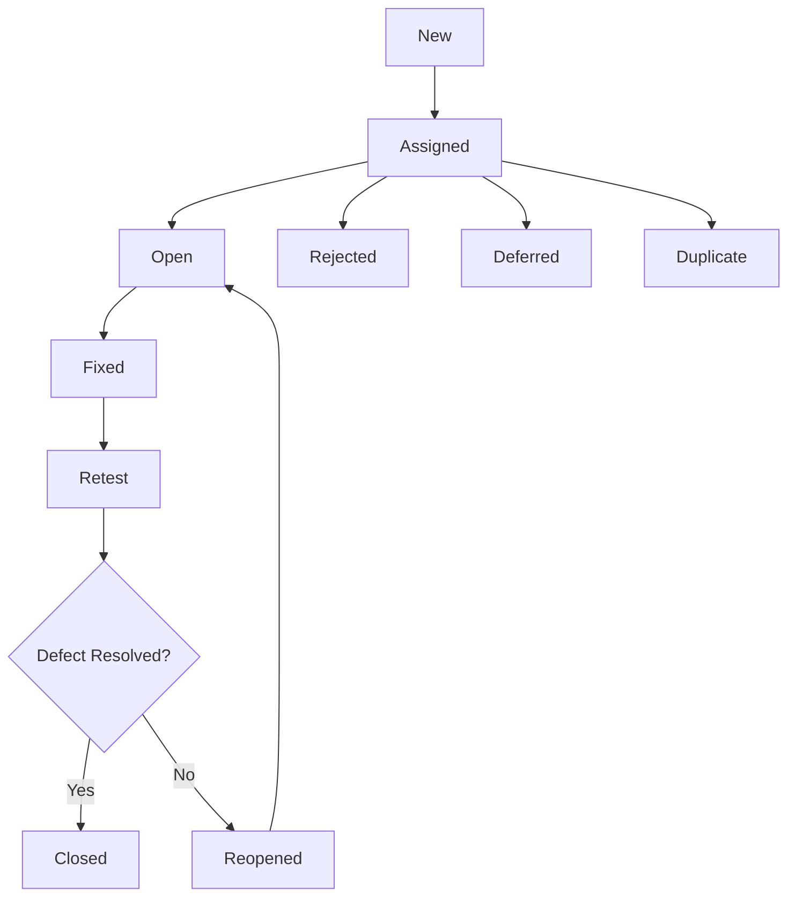

# Software Test Plan – SauceDemo

## 1. Document Information

| Field | Details |
|---|---|
| Project Name | SauceDemo E-commerce Application |
| Document Type | Software Test Plan |
| Test Plan ID | TP-001 |
| Version | 1.0 |
| Prepared By | Vishal Sharma |
| Role | QA Engineer - Independent Practice Project |
| Status | Planned |
| Testing Type | Manual Testing |
| Application URL | https://www.saucedemo.com/ |

## 2. Reference Documents

- [Business Requirement Document](../01-Requirements/BRD.md)
- [Functional Requirement Document](../01-Requirements/FRD.md)
- [Software Requirement Specification](../01-Requirements/SRS.md)

## 3. Purpose

This test plan defines the scope, objectives,
testing methodology, resources, responsibilities,
schedule, deliverables, risks and completion criteria
for the SauceDemo application.

The objective is to demonstrate a structured
Software Testing Life Cycle and QA operational process.

## 4. Testing Objectives

- Validate business and functional requirements.
- Verify critical application functionality.
- Validate complete end-to-end user journeys.
- Identify functional and UI/UX defects.
- Verify authentication and session behavior.
- Validate product and shopping cart information.
- Verify checkout calculations.
- Validate positive and negative scenarios.
- Ensure consistency across selected browsers.
- Maintain requirement traceability.
- Document testing results and quality risks.
- Prepare a simulated release recommendation.

## 5. Testing Scope

### 5.1 In Scope

| Module ID | Module | Priority |
|---|---|---|
| MOD-001 | Login and Authentication | High |
| MOD-002 | Product Listing | High |
| MOD-003 | Product Details | Medium |
| MOD-004 | Product Sorting | Medium |
| MOD-005 | Shopping Cart | High |
| MOD-006 | Checkout Information | High |
| MOD-007 | Order Summary | High |
| MOD-008 | Order Confirmation | High |
| MOD-009 | Application Navigation | Medium |
| MOD-010 | Logout and Session Management | High |
| MOD-011 | UI/UX Validation | Medium |
| MOD-012 | Error Handling | High |
| MOD-013 | Browser Compatibility | Medium |
| MOD-014 | Responsive Layout | Medium |

### 5.2 Out of Scope

- Real payment gateway testing.
- Real financial transactions.
- Backend database testing.
- Internal API testing.
- Source code review.
- Unit testing.
- Advanced security and penetration testing.
- Load and stress testing.
- Native Android application testing.
- Native iOS application testing.
- Actual production deployment.
- Formal accessibility compliance certification.

## 6. Testing Approach

The project will follow a manual black-box
testing approach based on proposed requirements,
business workflows and observed application behavior.

Testing will be prioritized according to
business impact and functional risk.

### Testing Process

1. Requirement Analysis
2. Test Planning
3. Test Scenario Preparation
4. Test Case Design
5. Test Data Preparation
6. Environment Validation
7. Smoke Testing
8. Functional Test Execution
9. Defect Reporting
10. Retesting, where fixes are available
11. Regression Testing
12. Quality Reporting
13. Test Closure

## 7. Testing Types

| Testing Type | Purpose |
|---|---|
| Smoke Testing | Verify critical application stability |
| Sanity Testing | Validate selected functionality after a known change |
| Functional Testing | Verify expected feature behavior |
| Regression Testing | Verify existing functionality after changes or through repeat execution |
| Retesting | Verify a previously reported defect after a fix |
| End-to-End Testing | Validate complete business workflows |
| System Testing | Validate overall application behavior |
| Integration Testing | Validate interactions between visible application modules |
| Exploratory Testing | Identify unexpected behavior through exploration |
| Ad Hoc Testing | Perform informal application checks |
| Positive Testing | Validate expected valid inputs |
| Negative Testing | Validate invalid inputs and error handling |
| UI Testing | Validate interface elements and layout |
| UX Testing | Review user journeys and usability |
| Compatibility Testing | Verify selected browser compatibility |
| Responsive Testing | Validate different viewport sizes |
| Accessibility Checks | Review basic keyboard interaction |
| Session Testing | Validate authentication and logout behavior |
| Data Validation | Verify displayed data consistency |

Sanity testing and defect retesting will only
be performed when relevant changes or fixes
are available.

## 8. Test Design Techniques

### Boundary Value Analysis

Validate input boundaries where documented
or reasonably established limits are available.

### Equivalence Partitioning

Group input data into valid and invalid categories.

### Decision Table Testing

Validate combinations of conditions and
their expected outcomes.

### State Transition Testing

Validate application state changes such as:

- Logged Out to Logged In
- Product Available to Product Added
- Product Added to Product Removed
- Checkout Initiated to Order Completed
- Logged In to Logged Out

### Error Guessing

Explore potential defects based on common
application failure patterns.

### Risk-Based Testing

Prioritize functionality according to
business impact and failure probability.

## 9. Test Environment

| Component | Details |
|---|---|
| Application | SauceDemo |
| Environment | Public Demo |
| Operating System | Windows |
| Primary Browser | Google Chrome |
| Secondary Browser | Microsoft Edge |
| Browser Versions | To be recorded |
| OS Version | To be recorded |
| Desktop Resolution | To be recorded |
| Mobile Viewport | Chrome DevTools |
| Internet Connection | Required |
| Test Management | GitHub and Microsoft Excel |
| Defect Management | GitHub Issues or defect report files |
| Evidence Collection | Screenshots and screen recordings |

Mobile viewport testing does not represent
native mobile application testing.

## 10. Test Data

### Authentication Data

| Data ID | Username | Password | Purpose |
|---|---|---|---|
| TD-001 | standard_user | secret_sauce | Valid login |
| TD-002 | locked_out_user | secret_sauce | Restricted account |
| TD-003 | invalid_user | secret_sauce | Invalid username |
| TD-004 | standard_user | invalid_password | Invalid password |
| TD-005 | Empty | secret_sauce | Username validation |
| TD-006 | standard_user | Empty | Password validation |
| TD-007 | Empty | Empty | Mandatory field validation |

The credentials above are intended for
public demonstration testing.

Availability will be verified before execution.

### Checkout Data

| Data ID | First Name | Last Name | Postal Code |
|---|---|---|---|
| TD-008 | Test | User | 12345 |
| TD-009 | Empty | User | 12345 |
| TD-010 | Test | Empty | 12345 |
| TD-011 | Test | User | Empty |
| TD-012 | Empty | Empty | Empty |
| TD-013 | Test123 | User | 12345 |
| TD-014 | Test | User | ABCDE |
| TD-015 | Test | User | 00000 |

Unspecified input format behavior will
be recorded as exploratory observations.

All customer information is synthetic.

## 11. Roles and Responsibilities

| Role | Responsibility |
|---|---|
| QA Engineer | Requirement analysis, test design, execution and reporting |
| QA Lead | Review testing scope, risks and quality status |
| Product Owner | Clarify business expectations |
| Business Analyst | Review business and functional requirements |
| Developer | Investigate and resolve defects |
| Scrum Master | Facilitate Agile activities and blocker resolution |
| Project Manager | Coordinate project delivery |
| Stakeholder | Review business acceptance and quality outcomes |

This is an independent project.

Only the QA Engineer activities are performed
by the project author. Other roles represent
a simulated organizational structure.

## 12. Sprint-Based Testing Schedule

| Sprint | Activities | Estimated Duration |
|---|---|---|
| Sprint 1 | Requirement analysis, BRD, FRD, SRS, test planning | 2 days |
| Sprint 2 | Test design, login, products, sorting and cart testing | 3 days |
| Sprint 3 | Checkout, order summary, confirmation and session testing | 3 days |
| Sprint 4 | Regression, UI/UX, compatibility, reporting and closure | 2 days |

Total Estimated Duration: 10 working days.

The schedule is proposed and may change
according to actual project progress.

## 13. QA Operational Activities

- Maintain testing task status.
- Prioritize critical testing activities.
- Track requirement coverage.
- Identify and communicate blockers.
- Maintain defect documentation.
- Monitor test execution progress.
- Document testing dependencies.
- Prepare simulated sprint status reports.
- Record requirement clarification items.
- Communicate outstanding quality risks.
- Maintain test evidence.
- Prepare release readiness recommendations.
- Document lessons learned.

## 14. Entry Criteria

Testing may begin when:

- Application is accessible.
- Proposed requirements are documented.
- Testing scope is defined.
- Required browsers are available.
- Test data is prepared.
- Test cases are documented.
- Testing environment is available.
- Known limitations are recorded.

## 15. Exit Criteria

Testing may be concluded when:

- All high-priority test cases have been executed.
- Critical business workflows have been validated.
- Planned requirement coverage has been reviewed.
- Test execution results are documented.
- Identified defects have been reported.
- Applicable regression testing is completed.
- Outstanding defects and risks are documented.
- Test summary report is prepared.

### Proposed Release Recommendation Criteria

- No unresolved critical defects.
- No unresolved high-impact defects affecting critical workflows.
- All high-priority requirements are covered.
- Critical end-to-end workflows pass.
- Remaining risks are clearly documented.

These criteria support a simulated recommendation,
not actual production approval.

## 16. Suspension Criteria

Testing may be suspended when:

- Application becomes unavailable.
- Valid demo credentials stop working.
- Critical functionality prevents further execution.
- Required testing environment is unavailable.
- Internet connectivity prevents reliable testing.
- Application behavior changes significantly.
- Required test data becomes unavailable.

## 17. Resumption Criteria

Testing may resume when:

- Application availability is restored.
- Blocking issues are resolved or bypassed safely.
- Required test data becomes available.
- Testing environment is stable.
- Affected test cases are identified.
- Smoke testing confirms readiness.

## 18. Defect Management

Each defect report will include:

- Defect ID
- Defect Title
- Module
- Requirement ID
- Test Case ID
- Environment
- Browser Version
- Preconditions
- Test Data
- Steps to Reproduce
- Expected Result
- Actual Result
- Severity
- Priority
- Status
- Supporting Evidence

### Severity Classification

| Severity | Description |
|---|---|
| Critical | Core application or critical business workflow is unusable |
| High | Major functionality fails without an acceptable workaround |
| Medium | Partial functionality is affected or a workaround exists |
| Low | Minor functional, visual or content issue |

### Priority Classification

| Priority | Description |
|---|---|
| P1 - Urgent | Requires immediate attention |
| P2 - High | Should be addressed at the earliest opportunity |
| P3 - Medium | Can be addressed in a planned cycle |
| P4 - Low | Can be addressed when resources permit |

Severity represents business or technical impact.

Priority represents the urgency of resolution.

## 19. Defect Life Cycle

The lifecycle is a reference process.

Actual developer assignments, fixes and closures
will not be claimed without supporting evidence.

## 20. Test Execution Status

| Status | Description |
|---|---|
| Not Executed | Test case has not been executed |
| Pass | Actual result matches expected result |
| Fail | Actual result does not match expected result |
| Blocked | Test case cannot be completed |
| Not Applicable | Test case is not applicable to the environment |

## 21. QA Metrics

| Metric | Formula |
|---|---|
| Total Test Cases | Count of documented test cases |
| Executed Test Cases | Passed + Failed |
| Execution Percentage | Executed / Applicable Test Cases x 100 |
| Pass Percentage | Passed / Executed x 100 |
| Failure Percentage | Failed / Executed x 100 |
| Blocked Percentage | Blocked / Applicable Test Cases x 100 |
| Requirement Coverage | Mapped Requirements / Total Requirements x 100 |
| Total Defects | Count of unique documented defects |
| Defect Reopen Rate | Reopened Defects / Previously Closed Defects x 100 |

Applicable Test Cases exclude cases marked
Not Applicable.

Metrics with a zero denominator will be
reported as Not Applicable.

Actual values will be calculated after execution.

## 22. Risk Management

| Risk ID | Risk | Impact | Mitigation |
|---|---|---|---|
| R-001 | Application unavailable | High | Record blocker and retry |
| R-002 | Authentication failure | High | Prioritize login testing |
| R-003 | Incorrect product information | High | Validate data across screens |
| R-004 | Shopping cart inconsistency | High | Execute cart scenarios |
| R-005 | Checkout failure | High | Prioritize end-to-end testing |
| R-006 | Incorrect order calculation | High | Independently verify arithmetic |
| R-007 | Session management failure | High | Validate protected page access |
| R-008 | Browser compatibility issue | Medium | Execute cross-browser checks |
| R-009 | UI layout issue | Medium | Validate selected viewports |
| R-010 | Incomplete requirements | Medium | Document assumptions and gaps |
| R-011 | Unavailable developer fixes | High | Record unresolved defects |
| R-012 | Insufficient testing time | Medium | Apply risk-based prioritization |

## 23. Test Deliverables

### Before Test Execution

- BRD
- FRD
- SRS
- Test Plan
- Test Strategy
- Test Scenarios
- Test Cases
- Requirement Traceability Matrix
- Test Data
- Testing Checklists

### During Test Execution

- Test Execution Records
- Defect Reports
- Screenshots
- Screen Recordings
- Blocker Records
- Sprint QA Reports
- Requirement Clarification Notes

### After Test Execution

- Regression Testing Report
- QA Metrics Report
- Defect Summary
- Release Readiness Checklist
- Test Summary Report
- Lessons Learned

## 24. Communication and Reporting

| Report | Frequency |
|---|---|
| Test Execution Status | Each testing session |
| Defect Report | When a defect is identified |
| Blocker Report | When testing is blocked |
| Sprint QA Report | End of each simulated sprint |
| QA Metrics Report | End of each testing cycle |
| Test Summary Report | At project closure |

Reports will be maintained within the
project repository.

## 25. Test Closure Activities

- Review completed test cases.
- Review requirement coverage.
- Review unresolved defects.
- Calculate QA metrics.
- Organize supporting evidence.
- Document testing limitations.
- Prepare test summary report.
- Prepare simulated release recommendation.
- Record lessons learned.
- Update repository documentation.

## 26. Assumptions and Limitations

- Requirements are independently proposed.
- Official SauceDemo specifications are unavailable.
- Testing is limited to publicly accessible features.
- No internal database or API access is available.
- No actual development team is involved.
- Application changes are outside tester control.
- Developer fixes cannot be guaranteed.
- Sprint activities are simulated.
- Test results will be based on actual execution.

## 27. Document Revision History

| Version | Description | Author |
|---|---|---|
| 1.0 | Initial Software Test Plan | Vishal Sharma |

## 28. Disclaimer

This test plan is independently prepared for
educational practice and professional QA
portfolio development.

It does not represent an official SauceDemo
testing document.

No confidential company or client information
is included.
