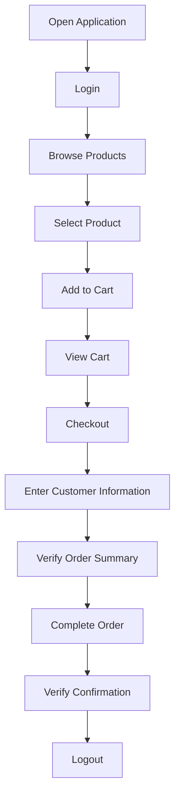
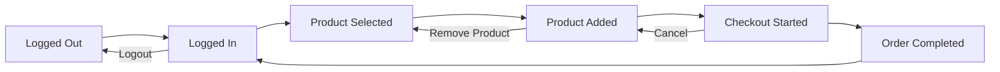
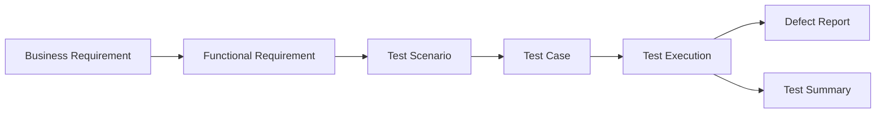

# Software Test Strategy – SauceDemo

## 1. Document Information

| Field | Details |
|---|---|
| Project Name | SauceDemo E-commerce Application |
| Document Type | Software Test Strategy |
| Strategy ID | STR-001 |
| Version | 1.0 |
| Prepared By | Vishal Sharma |
| Role | QA Engineer - Independent Practice Project |
| Status | Planned |
| Testing Approach | Manual Black Box Testing |
| Application URL | https://www.saucedemo.com/ |

## 2. Reference Documents

- [BRD](../01-Requirements/BRD.md)
- [FRD](../01-Requirements/FRD.md)
- [SRS](../01-Requirements/SRS.md)
- [Test Plan](Test-Plan.md)

## 3. Purpose

This document defines the overall testing
methodology, quality assurance approach,
test design techniques, risk-based testing
strategy and defect management process
for the SauceDemo application.

The strategy aims to ensure systematic
validation of business requirements,
functional workflows and application quality.

## 4. Quality Objectives

- Ensure critical business workflows are validated.
- Maximize requirement and functional coverage.
- Identify defects through structured testing.
- Reduce the risk of critical workflow failures.
- Validate data consistency across application modules.
- Ensure appropriate error handling.
- Maintain clear and traceable QA documentation.
- Provide evidence-based quality recommendations.
- Support continuous testing process improvement.

## 5. Testing Methodology

The project will follow a manual black-box
testing methodology.

Testing will focus on application inputs,
outputs, user interactions and expected
functional behavior without accessing
internal source code.

### Core Testing Approaches

- Requirement-Based Testing
- Risk-Based Testing
- Scenario-Based Testing
- Exploratory Testing
- User Journey-Based Testing
- Positive and Negative Testing
- Experience-Based Testing
- Data-Driven Manual Testing

## 6. Testing Levels

| Testing Level | Approach | Applicability |
|---|---|---|
| Unit Testing | Individual code component validation | Out of Scope |
| Integration Testing | Visible interaction between application modules | In Scope |
| System Testing | Complete application validation | In Scope |
| End-to-End Testing | Complete business workflow validation | In Scope |
| UAT-Style Testing | Business acceptance scenario validation | Simulated |

Actual client acceptance and production
approval are outside the project scope.

## 7. Functional Testing Strategy

### 7.1 Authentication Testing

- Validate valid credentials.
- Validate invalid credentials.
- Validate mandatory login fields.
- Validate locked-out user behavior.
- Verify successful login redirection.
- Verify unauthorized page access restrictions.
- Verify logout functionality.

### 7.2 Product Testing

- Verify product listing.
- Validate product names and descriptions.
- Verify product images.
- Validate product prices.
- Verify product details navigation.
- Validate all available sorting options.
- Verify consistency across product screens.

### 7.3 Shopping Cart Testing

- Add individual products.
- Add multiple products.
- Remove selected products.
- Validate cart count.
- Verify cart information.
- Verify continue shopping functionality.
- Validate cart consistency during navigation.

### 7.4 Checkout Testing

- Verify checkout navigation.
- Validate mandatory customer information.
- Verify missing field error messages.
- Explore invalid input combinations.
- Verify checkout cancellation.
- Validate progression to order summary.

### 7.5 Order Summary Testing

- Verify selected product information.
- Validate product prices and quantities.
- Independently calculate item subtotal.
- Verify displayed tax amount.
- Validate final total calculation.
- Verify Finish and Cancel functionality.

### 7.6 Order Confirmation Testing

- Verify successful order confirmation.
- Validate confirmation message.
- Verify Back Home functionality.
- Verify cart state after order completion.

### 7.7 Session and Navigation Testing

- Verify menu controls.
- Validate navigation between modules.
- Verify browser refresh behavior.
- Explore browser back and forward behavior.
- Validate logout.
- Verify protected page access after logout.

## 8. Non-Functional Testing Strategy

| Testing Area | Approach |
|---|---|
| Usability | Review navigation and user interaction |
| Compatibility | Execute critical flows in Chrome and Edge |
| Responsiveness | Validate desktop and mobile browser viewports |
| Reliability | Repeat critical business workflows |
| Accessibility | Basic keyboard and focus checks |
| Performance | Observe response behavior during normal usage |
| Security | Basic authentication and session validation |
| Error Handling | Verify meaningful validation messages |

Formal performance benchmarks, penetration
testing and accessibility certification
are outside the scope.

## 9. Smoke Testing Strategy

Smoke testing will verify whether the
application is stable enough for detailed testing.

### Critical Smoke Coverage

- Application availability.
- Valid user login.
- Product listing availability.
- Product details navigation.
- Add product to cart.
- Open shopping cart.
- Initiate checkout.
- Complete valid checkout.
- Verify order confirmation.
- Logout.

If a critical smoke test fails, affected
testing activities will be suspended and
the blocker will be documented.

## 10. Sanity Testing Strategy

Sanity testing will focus on selected
functionality following a known application
change or defect fix.

### Approach

- Identify the changed functionality.
- Review affected requirements.
- Execute targeted test cases.
- Verify related dependent functionality.
- Record actual results.
- Determine whether further regression is required.

Sanity testing will only be performed
when a relevant change is available.

## 11. Regression Testing Strategy

Regression testing will validate that
existing functionality remains unaffected
following application changes.

### Regression Coverage

- Authentication
- Product Listing
- Product Sorting
- Product Details
- Shopping Cart
- Checkout
- Order Summary
- Order Confirmation
- Navigation
- Logout
- Error Handling

### Regression Prioritization

| Priority | Coverage |
|---|---|
| P1 | Critical business workflows |
| P2 | Major functional modules |
| P3 | Supporting functionality |
| P4 | Minor visual and usability checks |

If no application changes are available,
repeat execution will be documented as
baseline stability testing rather than
verified post-change regression testing.

## 12. Retesting Strategy

Retesting will verify whether a previously
reported defect has been resolved.

### Retesting Process

1. Review the original defect report.
2. Confirm that a fix is available.
3. Reproduce the original test conditions.
4. Execute the associated test case.
5. Compare expected and actual results.
6. Capture supporting evidence.
7. Update the defect status.
8. Perform related regression checks if required.

Defects will not be marked as fixed or
closed without actual verification.

## 13. End-to-End Testing Strategy

The primary end-to-end workflow will cover:

### Additional End-to-End Scenarios

- Single product purchase.
- Multiple product purchase.
- Product removal before checkout.
- Checkout cancellation.
- Invalid checkout information.
- Navigation between cart and product listing.
- Logout and subsequent login.

## 14. Test Design Techniques

### 14.1 Equivalence Partitioning

Input data will be divided into groups
with similar expected behavior.

| Input | Valid Partition | Invalid Partition |
|---|---|---|
| Username | Valid demo username | Unknown username |
| Password | Valid demo password | Incorrect password |
| First Name | Non-empty input | Empty input |
| Last Name | Non-empty input | Empty input |
| Postal Code | Non-empty input | Empty input |

Additional input format restrictions
will be treated as exploratory until
supported by requirements.

### 14.2 Boundary Value Analysis

Boundary testing will be performed where
documented or established limits exist.

Examples:

- Empty cart.
- Cart containing one product.
- Cart containing multiple products.
- All available products added.
- Empty mandatory input.
- Single-character input.
- Long text input as exploratory testing.

Unknown field length restrictions will
not be treated as confirmed requirements.

### 14.3 Decision Table Testing

| Valid Username | Valid Password | Account Active | Expected Result |
|---|---|---|---|
| Yes | Yes | Yes | Login Successful |
| Yes | No | Yes | Access Denied |
| No | Yes | Not Applicable | Access Denied |
| No | No | Not Applicable | Access Denied |
| Yes | Yes | No | Access Denied |

### 14.4 State Transition Testing

### 14.5 Error Guessing

Explore common failure conditions:

- Repeated button clicks.
- Unexpected page refresh.
- Browser back navigation.
- Empty mandatory fields.
- Multiple cart operations.
- Checkout cancellation.
- Direct protected page navigation.
- Long or unusual text inputs.
- Network interruption.

### 14.6 Exploratory Testing

Exploratory testing will combine application
learning, test design and execution.

Each exploratory session will record:

- Session objective.
- Module under exploration.
- Test environment.
- Duration.
- Actions performed.
- Observations.
- Identified defects.
- Supporting evidence.
- Follow-up testing requirements.

## 15. Risk-Based Testing Strategy

Testing priority will be determined by
business impact and estimated likelihood
of failure.

Risk Score = Impact x Likelihood

### Risk Rating Scale

| Score | Risk Level |
|---|---|
| 15 to 25 | High |
| 6 to 14 | Medium |
| 1 to 5 | Low |

Impact and likelihood are rated from 1 to 5.

### Initial Risk Assessment

| Module | Impact | Likelihood | Score | Risk |
|---|---|---|---|---|
| Authentication | 5 | 4 | 20 | High |
| Product Listing | 4 | 3 | 12 | Medium |
| Product Sorting | 3 | 3 | 9 | Medium |
| Shopping Cart | 5 | 4 | 20 | High |
| Checkout | 5 | 4 | 20 | High |
| Order Calculation | 5 | 4 | 20 | High |
| Order Confirmation | 5 | 3 | 15 | High |
| Session Management | 5 | 3 | 15 | High |
| Navigation | 3 | 3 | 9 | Medium |
| Minor Visual Issues | 2 | 2 | 4 | Low |

These are initial estimated risk ratings,
not historical defect statistics.

Risk ratings may be updated based on
actual testing observations.

## 16. Test Environment Strategy

| Component | Planned Environment |
|---|---|
| Operating System | Windows |
| Primary Browser | Google Chrome |
| Secondary Browser | Microsoft Edge |
| Application | Public SauceDemo Website |
| Test Management | Microsoft Excel and GitHub |
| Defect Tracking | GitHub Issues or defect report files |
| Evidence | Screenshots and screen recordings |
| Mobile Viewport | Browser Developer Tools |

### Proposed Viewport Coverage

| Device Category | Viewport |
|---|---|
| Mobile | 375 x 667 |
| Mobile | 390 x 844 |
| Tablet | 768 x 1024 |
| Laptop | 1366 x 768 |
| Desktop | 1920 x 1080 |

These are selected testing viewports,
not official supported device specifications.

Actual browser versions and tested
viewports will be recorded during execution.

## 17. Test Data Management Strategy

- Use publicly provided demo credentials.
- Use synthetic customer information.
- Maintain unique test data identifiers.
- Include valid and invalid input combinations.
- Avoid real customer or financial information.
- Maintain consistent test data references.
- Reset application state where required.
- Record data dependencies.
- Avoid unintended dependencies between test cases.

## 18. Requirement Traceability Strategy

Every documented test case should be
traceable to a functional requirement
where applicable.

The RTM will identify:

- Covered requirements.
- Uncovered requirements.
- Associated test cases.
- Execution status.
- Failed requirements.
- Related defect references.
- Outstanding coverage gaps.

## 19. Defect Management Strategy

Defects will be documented using unique IDs
and reproducible steps.

### Defect Reporting Standards

- Clear and descriptive title.
- Accurate module identification.
- Requirement and test case references.
- Detailed reproduction steps.
- Expected and actual results.
- Appropriate severity and priority.
- Environment information.
- Supporting evidence.
- Current defect status.

### Defect Classification

| Severity | Description |
|---|---|
| Critical | Critical business workflow unavailable |
| High | Major functionality affected |
| Medium | Partial functionality affected |
| Low | Minor visual or functional issue |

### Defect Triage Approach

- Review reproducibility.
- Review requirement references.
- Assess business impact.
- Identify duplicate reports.
- Assign proposed severity.
- Assign proposed priority.
- Identify testing dependencies.
- Record unresolved risks.

Actual developer triage and assignment
are outside the independent project scope.

## 20. Requirement Clarification Strategy

When application behavior is unclear:

1. Review the BRD, FRD and SRS.
2. Review available application information.
3. Identify the requirement gap.
4. Record observed behavior.
5. Document the expected behavior assumption.
6. Classify the item as a clarification or observation.
7. Avoid reporting unsupported assumptions as confirmed defects.

## 21. QA Operational Strategy

The project will demonstrate the following
QA operational activities:

- Requirement review.
- Test scope management.
- Task prioritization.
- Sprint-based testing.
- Execution progress tracking.
- Defect tracking.
- Blocker management.
- Risk assessment.
- Issue escalation documentation.
- Quality status reporting.
- Release readiness assessment.
- Process improvement.

Organizational roles and sprint activities
are simulated for portfolio practice.

## 22. Agile Testing Strategy

### Before Sprint Execution

- Review proposed requirements.
- Identify testing scope.
- Estimate testing effort.
- Identify dependencies.
- Prepare test scenarios.
- Prepare test data.

### During Sprint Execution

- Execute prioritized test cases.
- Record actual results.
- Report identified defects.
- Track testing blockers.
- Update testing progress.
- Review requirement coverage.

### End of Sprint

- Review completed testing.
- Review outstanding defects.
- Calculate QA metrics.
- Prepare sprint QA report.
- Document unresolved risks.
- Identify improvement opportunities.

## 23. Automation Strategy

Automation is outside the current
manual testing project scope.

Potential future automation candidates:

- Valid login.
- Invalid login validation.
- Product sorting.
- Add and remove products.
- Shopping cart validation.
- Checkout workflow.
- Order confirmation.
- Logout.

Future automation may be implemented
using Playwright or Selenium in a
separate portfolio project.

No automation implementation is claimed
in this repository.

## 24. Quality Metrics Strategy

| Metric | Formula |
|---|---|
| Execution Percentage | Executed / Applicable Test Cases x 100 |
| Pass Percentage | Passed / Executed x 100 |
| Failure Percentage | Failed / Executed x 100 |
| Blocked Percentage | Blocked / Applicable Test Cases x 100 |
| Requirement Coverage | Mapped Requirements / Total Requirements x 100 |
| Defect Count | Total unique documented defects |
| Critical Defect Count | Number of critical defects |
| Open Defect Count | Number of unresolved defects |

Executed test cases are defined as
Passed plus Failed.

Applicable test cases exclude cases
marked Not Applicable.

Metrics will be calculated from actual
execution records.

Zero denominator calculations will
be reported as Not Applicable.

## 25. Release Readiness Strategy

A simulated release recommendation will
consider:

- Critical workflow execution.
- High-priority requirement coverage.
- Test execution results.
- Open critical and high-impact defects.
- Outstanding testing blockers.
- Regression or baseline stability results.
- Known limitations.
- Remaining business risks.

### Recommendation Categories

| Recommendation | Description |
|---|---|
| Go | Critical workflows pass and acceptance criteria are met |
| Conditional Go | Remaining risks require explicit acceptance |
| No-Go | Critical failures or unacceptable risks remain |

This recommendation is educational
and does not represent actual production approval.

## 26. Continuous Improvement

- Review missed testing scenarios.
- Improve test case quality.
- Identify repetitive manual activities.
- Improve requirement traceability.
- Review defect reporting quality.
- Improve evidence organization.
- Update testing checklists.
- Record lessons learned.
- Identify future automation opportunities.

## 27. Assumptions and Limitations

- Official SauceDemo requirements are unavailable.
- Requirements are independently proposed.
- Risk ratings are initial estimates.
- No internal API or database access is available.
- No development team is involved.
- Application fixes cannot be controlled.
- Sprint activities are simulated.
- Actual testing results are pending.
- No confidential client information is used.

## 28. Document Revision History

| Version | Description | Author |
|---|---|---|
| 1.0 | Initial Software Test Strategy | Vishal Sharma |

## 29. Disclaimer

This document is independently prepared
for educational practice and professional
QA portfolio development.

It is not an official SauceDemo
test strategy document.

All test execution results, defect reports
and quality metrics will be based on
actual testing observations.
