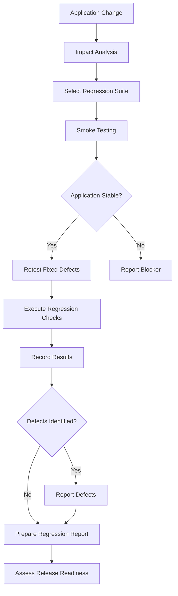

# Regression Testing Checklist – SauceDemo

## 1. Document Information

| Field | Details |
|---|---|
| Project Name | SauceDemo |
| Document Type | Regression Testing Checklist |
| Document ID | REG-DOC-001 |
| Version | 1.0 |
| Prepared By | Vishal Sharma |
| Testing Type | Manual Regression Testing |
| Environment | Public Demo |
| Application URL | https://www.saucedemo.com/ |
| Execution Status | Pending |

## 2. Objective

The objective of regression testing is to
ensure that existing application functionality
remains unaffected after application changes,
enhancements or defect fixes.

Regression testing focuses on functional
stability, business workflows, integration
between modules and overall application quality.

## 3. Reference Documents

- [BRD](../01-Requirements/BRD.md)
- [FRD](../01-Requirements/FRD.md)
- [SRS](../01-Requirements/SRS.md)
- [Test Plan](../02-Test-Planning/Test-Plan.md)
- [Test Strategy](../02-Test-Planning/Test-Strategy.md)
- [Test Scenarios](../03-Test-Design/Test-Scenarios.md)
- [Test Cases](../03-Test-Design/SauceDemo_Test_Cases.xlsx)
- [RTM](../03-Test-Design/SauceDemo_RTM.xlsx)
- [Bug Tracker](../04-Defect-Management/SauceDemo_Bug_Tracker.xlsx)
- [Smoke Testing Checklist](Smoke-Testing-Checklist.md)
- [Sanity Testing Checklist](Sanity-Testing-Checklist.md)

## 4. Regression Testing Triggers

Regression testing may be required after:

- New feature implementation.
- Existing functionality modification.
- Defect resolution.
- UI/UX updates.
- Business rule changes.
- Application deployment.
- Authentication changes.
- Checkout workflow changes.
- Browser compatibility updates.
- Major application configuration changes.

## 5. Regression Cycle Information

| Field | Details |
|---|---|
| Regression Cycle ID | REG-CYCLE-001 |
| Sprint ID | Pending |
| Release Version | Not Available |
| Build Version | Not Available |
| Change Description | Pending |
| Related Task IDs | Pending |
| Related Bug IDs | Pending |
| Affected Modules | Pending |
| Testing Start Date | Pending |
| Testing End Date | Pending |
| Tested By | Vishal Sharma |
| Execution Status | Pending |

## 6. Regression Testing Types

| Type | Description |
|---|---|
| Corrective Regression | Reuse existing test cases when requirements remain unchanged |
| Selective Regression | Execute selected tests based on change impact |
| Partial Regression | Validate changed functionality and dependent modules |
| Complete Regression | Execute the full applicable regression suite |
| Progressive Regression | Update test coverage when requirements change |

## 7. Regression Testing Approach

1. Review application changes.
2. Review affected requirements.
3. Perform change impact analysis.
4. Identify dependent modules.
5. Select relevant regression test cases.
6. Prioritize critical business workflows.
7. Prepare test environment and test data.
8. Perform smoke testing.
9. Retest fixed defects where applicable.
10. Execute selected regression checks.
11. Report newly identified defects.
12. Update test execution records.
13. Calculate QA metrics.
14. Prepare regression testing summary.
15. Provide a simulated release recommendation.

## 8. Entry Criteria

- Application environment is accessible.
- Relevant change information is available.
- Required test cases are documented.
- Test data is available.
- Smoke testing is completed successfully
  or outstanding risks are documented.
- Affected modules are identified.
- Regression scope is finalized.
- Previous execution records are available
  where applicable.

## 9. Regression Testing Checklist

### 9.1 Login and Authentication

| Regression ID | Checklist Item | Scenario ID | Priority | Status |
|---|---|---|---|---|
| REG-001 | Verify login page controls | TS-001 | High | Not Executed |
| REG-002 | Verify valid login | TS-002 | High | Not Executed |
| REG-003 | Verify invalid username | TS-003 | High | Not Executed |
| REG-004 | Verify invalid password | TS-004 | High | Not Executed |
| REG-005 | Verify empty username validation | TS-005 | High | Not Executed |
| REG-006 | Verify empty password validation | TS-006 | High | Not Executed |
| REG-007 | Verify empty login fields | TS-007 | High | Not Executed |
| REG-008 | Verify locked-out user behavior | TS-008 | High | Not Executed |
| REG-009 | Verify successful login redirection | TS-009 | High | Not Executed |
| REG-010 | Verify unauthorized page access | TS-010 | High | Not Executed |
| REG-011 | Verify password masking | TS-011 | Medium | Not Executed |
| REG-012 | Verify login error visibility | TS-015 | Medium | Not Executed |

### 9.2 Product Listing

| Regression ID | Checklist Item | Scenario ID | Priority | Status |
|---|---|---|---|---|
| REG-013 | Verify product listing | TS-016 | High | Not Executed |
| REG-014 | Verify product names | TS-017 | High | Not Executed |
| REG-015 | Verify product images | TS-018 | Medium | Not Executed |
| REG-016 | Verify product descriptions | TS-019 | Medium | Not Executed |
| REG-017 | Verify product prices | TS-020 | High | Not Executed |
| REG-018 | Verify Add to Cart controls | TS-021 | High | Not Executed |
| REG-019 | Verify Remove controls | TS-022 | High | Not Executed |
| REG-020 | Verify product details navigation | TS-023 | Medium | Not Executed |
| REG-021 | Verify product data consistency | TS-024 | High | Not Executed |
| REG-022 | Verify product listing layout | TS-025 | Medium | Not Executed |

### 9.3 Product Sorting

| Regression ID | Checklist Item | Scenario ID | Priority | Status |
|---|---|---|---|---|
| REG-023 | Verify name sorting A to Z | TS-026 | Medium | Not Executed |
| REG-024 | Verify name sorting Z to A | TS-027 | Medium | Not Executed |
| REG-025 | Verify price sorting low to high | TS-028 | Medium | Not Executed |
| REG-026 | Verify price sorting high to low | TS-029 | Medium | Not Executed |
| REG-027 | Verify cart consistency after sorting | TS-030 | High | Not Executed |
| REG-028 | Verify repeated sorting changes | TS-031 | Medium | Not Executed |

### 9.4 Product Details

| Regression ID | Checklist Item | Scenario ID | Priority | Status |
|---|---|---|---|---|
| REG-029 | Verify selected product details | TS-033 | High | Not Executed |
| REG-030 | Verify product information consistency | TS-034 | High | Not Executed |
| REG-031 | Verify Add to Cart from details page | TS-035 | High | Not Executed |
| REG-032 | Verify Remove from details page | TS-036 | High | Not Executed |
| REG-033 | Verify Back to Products navigation | TS-037 | Medium | Not Executed |
| REG-034 | Verify product details layout | TS-038 | Medium | Not Executed |

### 9.5 Shopping Cart

| Regression ID | Checklist Item | Scenario ID | Priority | Status |
|---|---|---|---|---|
| REG-035 | Verify adding single product | TS-039 | High | Not Executed |
| REG-036 | Verify adding multiple products | TS-040 | High | Not Executed |
| REG-037 | Verify cart count after adding products | TS-041 | High | Not Executed |
| REG-038 | Verify selected products in cart | TS-042 | High | Not Executed |
| REG-039 | Verify product names in cart | TS-043 | High | Not Executed |
| REG-040 | Verify product prices in cart | TS-044 | High | Not Executed |
| REG-041 | Verify product quantities | TS-045 | High | Not Executed |
| REG-042 | Verify removing single product | TS-046 | High | Not Executed |
| REG-043 | Verify removing multiple products | TS-047 | High | Not Executed |
| REG-044 | Verify cart count after removal | TS-048 | High | Not Executed |
| REG-045 | Verify empty cart state | TS-049 | High | Not Executed |
| REG-046 | Verify Continue Shopping | TS-050 | Medium | Not Executed |
| REG-047 | Verify cart persistence during navigation | TS-051 | High | Not Executed |
| REG-048 | Verify checkout navigation | TS-052 | High | Not Executed |
| REG-049 | Verify adding all available products | TS-055 | High | Not Executed |

### 9.6 Checkout Information

| Regression ID | Checklist Item | Scenario ID | Priority | Status |
|---|---|---|---|---|
| REG-050 | Verify checkout information fields | TS-056 | High | Not Executed |
| REG-051 | Verify valid checkout information | TS-057 | High | Not Executed |
| REG-052 | Verify empty first name validation | TS-058 | High | Not Executed |
| REG-053 | Verify empty last name validation | TS-059 | High | Not Executed |
| REG-054 | Verify empty postal code validation | TS-060 | High | Not Executed |
| REG-055 | Verify all mandatory fields empty | TS-061 | High | Not Executed |
| REG-056 | Verify checkout error messages | TS-062 | High | Not Executed |
| REG-057 | Verify checkout cancellation | TS-068 | Medium | Not Executed |
| REG-058 | Verify order summary navigation | TS-069 | High | Not Executed |
| REG-059 | Verify checkout form layout | TS-070 | Medium | Not Executed |

### 9.7 Order Summary

| Regression ID | Checklist Item | Scenario ID | Priority | Status |
|---|---|---|---|---|
| REG-060 | Verify selected products in summary | TS-071 | High | Not Executed |
| REG-061 | Verify product price consistency | TS-072 | High | Not Executed |
| REG-062 | Verify single-product subtotal | TS-073 | High | Not Executed |
| REG-063 | Verify multiple-product subtotal | TS-074 | High | Not Executed |
| REG-064 | Verify tax amount display | TS-075 | High | Not Executed |
| REG-065 | Verify final total calculation | TS-076 | High | Not Executed |
| REG-066 | Verify Finish button functionality | TS-077 | High | Not Executed |
| REG-067 | Verify order summary cancellation | TS-078 | Medium | Not Executed |
| REG-068 | Verify checkout data consistency | TS-079 | High | Not Executed |
| REG-069 | Verify order summary layout | TS-080 | Medium | Not Executed |

### 9.8 Order Confirmation

| Regression ID | Checklist Item | Scenario ID | Priority | Status |
|---|---|---|---|---|
| REG-070 | Verify order confirmation page | TS-081 | High | Not Executed |
| REG-071 | Verify confirmation message | TS-082 | High | Not Executed |
| REG-072 | Verify Back Home functionality | TS-083 | Medium | Not Executed |
| REG-073 | Verify cart clearance after order | TS-084 | High | Not Executed |

### 9.9 Navigation and Session Management

| Regression ID | Checklist Item | Scenario ID | Priority | Status |
|---|---|---|---|---|
| REG-074 | Verify application menu opens | TS-087 | Medium | Not Executed |
| REG-075 | Verify application menu closes | TS-088 | Medium | Not Executed |
| REG-076 | Verify All Items navigation | TS-089 | Medium | Not Executed |
| REG-077 | Verify About navigation | TS-090 | Low | Not Executed |
| REG-078 | Verify logout functionality | TS-092 | High | Not Executed |
| REG-079 | Verify logout redirection | TS-093 | High | Not Executed |
| REG-080 | Verify protected page access after logout | TS-094 | High | Not Executed |
| REG-081 | Verify browser back behavior after logout | TS-095 | High | Not Executed |
| REG-082 | Verify login after logout | TS-098 | High | Not Executed |

### 9.10 UI/UX and Accessibility

| Regression ID | Checklist Item | Scenario ID | Priority | Status |
|---|---|---|---|---|
| REG-083 | Verify application layout consistency | TS-099 | Medium | Not Executed |
| REG-084 | Verify text readability | TS-100 | Medium | Not Executed |
| REG-085 | Verify buttons and controls | TS-101 | High | Not Executed |
| REG-086 | Verify image rendering | TS-102 | Medium | Not Executed |
| REG-087 | Verify error message visibility | TS-103 | Medium | Not Executed |
| REG-088 | Verify form field alignment | TS-104 | Medium | Not Executed |
| REG-089 | Verify keyboard navigation | TS-105 | Medium | Not Executed |
| REG-090 | Verify keyboard focus indicators | TS-106 | Medium | Not Executed |
| REG-091 | Verify content overlap | TS-107 | Medium | Not Executed |
| REG-092 | Verify navigation accessibility | TS-108 | Medium | Not Executed |

### 9.11 Cross-Browser and Responsive Testing

| Regression ID | Checklist Item | Scenario ID | Priority | Status |
|---|---|---|---|---|
| REG-093 | Verify critical workflows in Chrome | TS-109 | High | Not Executed |
| REG-094 | Verify critical workflows in Edge | TS-110 | High | Not Executed |
| REG-095 | Verify 375 x 667 viewport | TS-111 | Medium | Not Executed |
| REG-096 | Verify 390 x 844 viewport | TS-112 | Medium | Not Executed |
| REG-097 | Verify 768 x 1024 viewport | TS-113 | Medium | Not Executed |
| REG-098 | Verify 1366 x 768 viewport | TS-114 | Medium | Not Executed |
| REG-099 | Verify 1920 x 1080 viewport | TS-115 | Medium | Not Executed |
| REG-100 | Verify mobile browser workflow | TS-116 | High | Not Executed |

### 9.12 End-to-End Testing

| Regression ID | Checklist Item | Scenario ID | Priority | Status |
|---|---|---|---|---|
| REG-101 | Verify single-product purchase | TS-117 | High | Not Executed |
| REG-102 | Verify multiple-product purchase | TS-118 | High | Not Executed |
| REG-103 | Verify purchase after product removal | TS-119 | High | Not Executed |
| REG-104 | Verify cancellation followed by checkout | TS-120 | High | Not Executed |
| REG-105 | Verify invalid followed by valid checkout | TS-121 | High | Not Executed |
| REG-106 | Verify sorting followed by purchase | TS-122 | High | Not Executed |
| REG-107 | Verify purchase followed by logout | TS-123 | High | Not Executed |
| REG-108 | Verify repeated purchase workflows | TS-124 | High | Not Executed |

## 10. Regression Coverage Summary

| Module | Total Checks |
|---|---:|
| Login and Authentication | 12 |
| Product Listing | 10 |
| Product Sorting | 6 |
| Product Details | 6 |
| Shopping Cart | 15 |
| Checkout Information | 10 |
| Order Summary | 10 |
| Order Confirmation | 4 |
| Navigation and Session Management | 9 |
| UI/UX and Accessibility | 10 |
| Cross-Browser and Responsive Testing | 8 |
| End-to-End Testing | 8 |
| Total | 108 |

The regression suite contains 108 reusable
checks selected from 132 designed test scenarios.

Additional exploratory scenarios may be
selected based on application changes and risks.

## 11. Regression Test Selection Strategy

| Change Area | Recommended Regression Coverage |
|---|---|
| Authentication | Login, navigation, session and logout |
| Product Listing | Products, sorting, details and cart |
| Shopping Cart | Products, cart, checkout and order summary |
| Checkout | Cart, checkout, calculations and confirmation |
| Order Calculation | Product prices, subtotal, tax and total |
| UI Changes | Affected screens, responsive layout and navigation |
| Major Release | Complete applicable regression suite |

## 12. Execution Status

| Status | Description |
|---|---|
| Pass | Expected result is achieved |
| Fail | Actual result differs from expected result |
| Blocked | Testing cannot proceed |
| Not Executed | Check has not been executed |
| Not Applicable | Check is not relevant to the selected cycle |

## 13. Regression Execution Summary

| Metric | Count |
|---|---:|
| Available Regression Checks | 108 |
| Selected Checks | 0 |
| Executed | 0 |
| Passed | 0 |
| Failed | 0 |
| Blocked | 0 |
| Pass Percentage | N/A |
| New Defects | 0 |
| Reopened Defects | 0 |

Executed = Passed + Failed

Execution Percentage =
Executed / Applicable Selected Checks x 100

Pass Percentage =
Passed / Executed x 100

Failure Percentage =
Failed / Executed x 100

Metrics with a zero denominator will be
reported as Not Applicable.

## 14. Regression Defect Tracking

| Regression ID | Bug ID | Severity | Priority | Status | Evidence |
|---|---|---|---|---|---|
| Pending | Pending | Pending | Pending | Pending | Pending |

All identified defects will be documented
in the project Bug Tracker.

Previously reported defects will only be
reopened when supported by actual evidence.

## 15. Regression Testing Workflow

Retesting is performed only when a
previously reported defect has a known fix.

## 16. Exit Criteria

- Selected high-priority checks are executed.
- Critical business workflows are validated.
- Regression results are documented.
- Identified defects are reported.
- Outstanding blockers are documented.
- Supporting evidence is maintained.
- Requirement coverage is reviewed.
- Regression metrics are calculated.
- Release risks are documented.
- Regression summary report is prepared.

## 17. Release Recommendation

| Recommendation | Description |
|---|---|
| Go | Critical workflows pass and acceptance criteria are met |
| Conditional Go | Remaining risks require explicit acceptance |
| No-Go | Critical failures or unacceptable risks remain |
| Pending | Regression execution is incomplete |

Current Recommendation: Pending

The recommendation is educational and
does not represent actual production approval.

## 18. QA Operational Responsibilities

- Review release and change information.
- Perform impact analysis.
- Maintain regression test suites.
- Prioritize testing activities.
- Track test execution progress.
- Maintain requirement traceability.
- Report defects and blockers.
- Review unresolved issues.
- Maintain screenshots and evidence.
- Prepare regression reports.
- Communicate quality risks.
- Assess release readiness.
- Identify process improvement opportunities.

## 19. Assumptions and Limitations

- This is an independent QA practice project.
- Official SauceDemo release notes are unavailable.
- Application deployments are outside tester control.
- Actual developer fixes cannot be guaranteed.
- Regression checks represent reusable coverage.
- Actual post-change regression testing requires
  an identifiable application change.
- Without a confirmed change, repeat execution
  will be recorded as baseline stability testing.
- Mobile testing refers to browser viewport testing.
- No internal API or database access is available.
- No execution results have been fabricated.

## 20. Revision History

| Version | Description | Author |
|---|---|---|
| 1.0 | Initial regression suite with 108 checks | Vishal Sharma |

## 21. Disclaimer

This document is independently prepared
for educational practice and professional
QA portfolio development.

It is not an official SauceDemo testing document.

All execution results and defect reports
will be based on actual application testing.

No confidential company or client information
is included.
