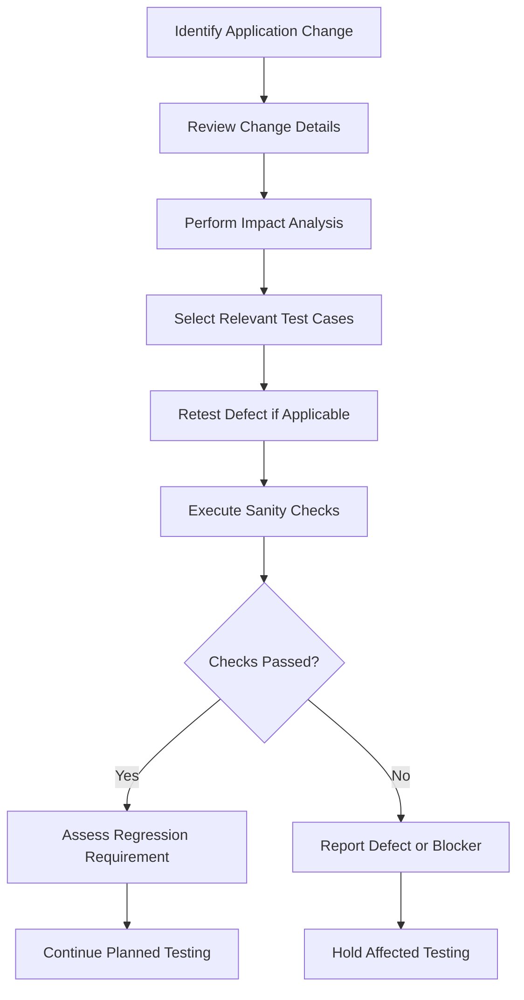

# Sanity Testing Checklist – SauceDemo

## 1. Document Information

| Field | Details |
|---|---|
| Project Name | SauceDemo |
| Document Type | Sanity Testing Checklist |
| Document ID | SNT-DOC-001 |
| Version | 1.0 |
| Prepared By | Vishal Sharma |
| Testing Type | Manual Sanity Testing |
| Environment | Public Demo |
| Application URL | https://www.saucedemo.com/ |
| Execution Status | Pending |

## 2. Objective

The objective of sanity testing is to verify
that recently modified functionality or
defect fixes work as expected.

Sanity testing also validates directly
related functionality to identify immediate
side effects introduced by a change.

## 3. Reference Documents

- [BRD](../01-Requirements/BRD.md)
- [FRD](../01-Requirements/FRD.md)
- [SRS](../01-Requirements/SRS.md)
- [Test Plan](../02-Test-Planning/Test-Plan.md)
- [Test Strategy](../02-Test-Planning/Test-Strategy.md)
- [Test Scenarios](../03-Test-Design/Test-Scenarios.md)
- [Test Cases](../03-Test-Design/SauceDemo_Test_Cases.xlsx)
- [RTM](../03-Test-Design/SauceDemo_RTM.xlsx)
- [Bug Tracker](../04-Defect-Management/SauceDemo_Bug_Tracker.xlsx)

## 4. Sanity Testing Scope

Sanity testing may be performed for:

- Newly modified functionality.
- Defect fixes.
- Updated validation rules.
- UI changes.
- Business workflow changes.
- Navigation changes.
- Shopping cart changes.
- Checkout calculation changes.
- Session management changes.

Only relevant checklist items will be
selected based on the affected functionality.

## 5. Change Information

| Field | Details |
|---|---|
| Change ID | Pending |
| Task ID | Pending |
| Bug ID | Pending |
| Sprint ID | Pending |
| Changed Module | Pending |
| Change Description | Pending |
| Affected Requirements | Pending |
| Affected Test Cases | Pending |
| Build Version | Not Available |
| Deployment Date | Pending |
| Testing Date | Pending |
| Tested By | Vishal Sharma |

Change information will be recorded when
a relevant application change is available.

## 6. Entry Criteria

- A relevant application change is identified.
- Change details are available.
- Affected functionality is identified.
- Related requirements are reviewed.
- Required test cases are selected.
- Testing environment is accessible.
- Required test data is available.
- A defect fix is available where applicable.

## 7. Change Impact Analysis

| Changed Module | Related Modules to Validate |
|---|---|
| Login | Authentication, Product Listing, Session |
| Product Listing | Product Details, Sorting, Cart |
| Product Sorting | Product Listing, Cart |
| Product Details | Product Listing, Cart |
| Shopping Cart | Product Listing, Checkout |
| Checkout | Cart, Order Summary |
| Order Summary | Checkout, Order Confirmation |
| Order Confirmation | Cart, Product Listing |
| Logout | Authentication, Session Management |
| UI/UX | Affected Screens and Controls |

## 8. Sanity Testing Checklist

### 8.1 Login and Authentication

| Sanity ID | Checklist Item | Scenario ID | Expected Result | Status |
|---|---|---|---|---|
| SNT-001 | Verify valid login after authentication change | TS-002 | Valid user logs in successfully | Not Executed |
| SNT-002 | Verify invalid credential validation | TS-004 | Invalid credentials are rejected | Not Executed |
| SNT-003 | Verify mandatory login fields | TS-007 | Required field validation appears | Not Executed |
| SNT-004 | Verify login redirection | TS-009 | Product listing opens successfully | Not Executed |
| SNT-005 | Verify locked-out account behavior | TS-008 | Restricted account cannot log in | Not Executed |

### 8.2 Product Listing and Sorting

| Sanity ID | Checklist Item | Scenario ID | Expected Result | Status |
|---|---|---|---|---|
| SNT-006 | Verify product listing after changes | TS-016 | Products are displayed correctly | Not Executed |
| SNT-007 | Verify updated product information | TS-024 | Product information is consistent | Not Executed |
| SNT-008 | Verify product sorting | TS-026 to TS-029 | Products follow selected sorting order | Not Executed |
| SNT-009 | Verify cart consistency after sorting | TS-030 | Existing cart items remain unchanged | Not Executed |
| SNT-010 | Verify product details navigation | TS-023 | Correct product details open | Not Executed |

### 8.3 Product Details

| Sanity ID | Checklist Item | Scenario ID | Expected Result | Status |
|---|---|---|---|---|
| SNT-011 | Verify selected product details | TS-033 | Correct product information appears | Not Executed |
| SNT-012 | Verify Add to Cart functionality | TS-035 | Product is added successfully | Not Executed |
| SNT-013 | Verify Remove functionality | TS-036 | Product is removed successfully | Not Executed |
| SNT-014 | Verify Back to Products navigation | TS-037 | Product listing opens correctly | Not Executed |

### 8.4 Shopping Cart

| Sanity ID | Checklist Item | Scenario ID | Expected Result | Status |
|---|---|---|---|---|
| SNT-015 | Verify adding products after cart change | TS-039 | Selected product is added | Not Executed |
| SNT-016 | Verify removing products | TS-046 | Selected product is removed | Not Executed |
| SNT-017 | Verify cart count | TS-041, TS-048 | Cart count matches selected products | Not Executed |
| SNT-018 | Verify product information in cart | TS-043 to TS-045 | Product details remain consistent | Not Executed |
| SNT-019 | Verify cart persistence during navigation | TS-051 | Selected products remain in cart | Not Executed |
| SNT-020 | Verify checkout navigation | TS-052 | Checkout information page opens | Not Executed |

### 8.5 Checkout Information

| Sanity ID | Checklist Item | Scenario ID | Expected Result | Status |
|---|---|---|---|---|
| SNT-021 | Verify checkout with valid information | TS-057 | User proceeds to order summary | Not Executed |
| SNT-022 | Verify mandatory field validation | TS-058 to TS-061 | Appropriate validation appears | Not Executed |
| SNT-023 | Verify updated error messages | TS-062 | Relevant error messages are displayed | Not Executed |
| SNT-024 | Verify checkout cancellation | TS-068 | User returns to shopping cart | Not Executed |
| SNT-025 | Verify checkout form layout | TS-070 | Fields and controls are readable | Not Executed |

### 8.6 Order Summary

| Sanity ID | Checklist Item | Scenario ID | Expected Result | Status |
|---|---|---|---|---|
| SNT-026 | Verify selected products in summary | TS-071 | Correct products are displayed | Not Executed |
| SNT-027 | Verify subtotal calculation | TS-073, TS-074 | Subtotal matches selected product prices | Not Executed |
| SNT-028 | Verify tax display | TS-075 | Tax amount is displayed | Not Executed |
| SNT-029 | Verify final total calculation | TS-076 | Total equals subtotal plus displayed tax | Not Executed |
| SNT-030 | Verify Finish functionality | TS-077 | Simulated order completes successfully | Not Executed |

### 8.7 Order Confirmation

| Sanity ID | Checklist Item | Scenario ID | Expected Result | Status |
|---|---|---|---|---|
| SNT-031 | Verify order confirmation page | TS-081 | Confirmation page opens | Not Executed |
| SNT-032 | Verify confirmation message | TS-082 | Success message appears | Not Executed |
| SNT-033 | Verify cart state after order completion | TS-084 | Purchased items are cleared | Not Executed |
| SNT-034 | Verify Back Home functionality | TS-083 | Product listing opens successfully | Not Executed |

### 8.8 Navigation and Session Management

| Sanity ID | Checklist Item | Scenario ID | Expected Result | Status |
|---|---|---|---|---|
| SNT-035 | Verify application menu | TS-087, TS-088 | Menu opens and closes correctly | Not Executed |
| SNT-036 | Verify logout functionality | TS-092 | User logs out successfully | Not Executed |
| SNT-037 | Verify logout redirection | TS-093 | Login page opens | Not Executed |
| SNT-038 | Verify protected page access after logout | TS-094 | Unauthorized access is denied | Not Executed |

### 8.9 UI/UX Validation

| Sanity ID | Checklist Item | Scenario ID | Expected Result | Status |
|---|---|---|---|---|
| SNT-039 | Verify modified screen layout | TS-099 | Layout remains consistent | Not Executed |
| SNT-040 | Verify modified buttons and controls | TS-101 | Controls remain visible and functional | Not Executed |
| SNT-041 | Verify updated error message visibility | TS-103 | Error messages are readable | Not Executed |
| SNT-042 | Verify modified form alignment | TS-104 | Form elements are aligned correctly | Not Executed |
| SNT-043 | Verify affected responsive layout | TS-107 | Content does not overlap | Not Executed |

## 9. Defect Fix Verification

| Field | Details |
|---|---|
| Bug ID | Pending |
| Original Defect Description | Pending |
| Associated Test Case | Pending |
| Fix Description | Pending |
| Original Expected Result | Pending |
| Retest Actual Result | Pending |
| Retest Status | Not Executed |
| Related Sanity Checks | Pending |
| Evidence | Pending |
| Final Defect Status | Pending |

Retesting validates the original defect fix.

Sanity testing validates the affected
functionality and directly related features.

## 10. Sanity Testing Workflow

## 11. Execution Status

| Status | Description |
|---|---|
| Pass | Expected behavior is verified |
| Fail | Expected behavior is not achieved |
| Blocked | Testing cannot proceed |
| Not Executed | Check has not been executed |
| Not Applicable | Check is unrelated to the current change |

## 12. Sanity Testing Summary

| Metric | Count |
|---|---:|
| Available Sanity Checks | 43 |
| Selected Checks | 0 |
| Executed | 0 |
| Passed | 0 |
| Failed | 0 |
| Blocked | 0 |
| Pass Percentage | N/A |
| New Defects | 0 |
| Reopened Defects | 0 |

Executed = Passed + Failed

Pass Percentage = Passed / Executed x 100

Execution metrics will be calculated
for selected checks only.

## 13. Exit Criteria

- Relevant sanity checks are executed.
- Original defect is retested where applicable.
- Modified functionality is validated.
- Directly affected features are verified.
- Identified defects are documented.
- Supporting evidence is recorded.
- Further regression requirements are identified.
- Outstanding risks are documented.

## 14. Sanity Testing Decision

| Decision | Description |
|---|---|
| Proceed | Selected checks pass |
| Conditional Proceed | Minor issues exist but unaffected testing can continue |
| Hold | Relevant critical functionality fails |
| Pending | Sanity testing has not been completed |
| Not Applicable | No relevant application change is available |

Current Decision: Pending

## 15. QA Operational Activities

- Review change requests.
- Review affected requirements.
- Track task and defect IDs.
- Perform change impact analysis.
- Select relevant test cases.
- Verify defect fixes.
- Identify new defects.
- Update execution records.
- Communicate testing blockers.
- Assess regression testing requirements.
- Prepare QA status updates.

## 16. Assumptions and Limitations

- This is an independent QA practice project.
- Official change requests are unavailable.
- Actual developer fixes are not controlled
  by the project author.
- Sanity checks represent reusable test coverage.
- Only relevant checks will be selected
  after an identifiable application change.
- Without an actual change, targeted execution
  will be recorded as focused functional testing,
  not confirmed post-change sanity testing.
- No execution results have been fabricated.

## 17. Revision History

| Version | Description | Author |
|---|---|---|
| 1.0 | Initial Sanity Testing Checklist | Vishal Sharma |

## 18. Disclaimer

This document is independently prepared
for educational practice and professional
QA portfolio development.

All test results and defect reports will
be based on actual application behavior.

No confidential company or client information
is included.
